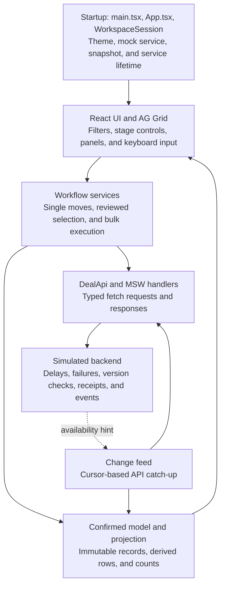

# DealDesk — product documentation

Sales pipeline workspace · Browser-only simulation · Application reference `7176d18`

<a id="document-index"></a>

## Document index

Use the linked sections below to navigate the product documentation. Page references apply to the PDF export.

| Section                                                            | Content highlights                                                                            | Page |
| ------------------------------------------------------------------ | --------------------------------------------------------------------------------------------- | ---: |
| [1. Assignment write-up](#summary)                                 | Product rationale, technical choices, UX decisions, and reliable updates.                     |    2 |
| [2. Contents and source requirements](#scope)                      | Source requirements, document scope, and key terminology.                                     |    4 |
| [3. Setup and first use](#setup)                                   | Prerequisites, local startup, and primary application controls.                               |    5 |
| [4. Architecture, technology, and design decisions](#architecture) | Technology decisions, repository map, workflows, styling, accessibility, and design patterns. |    6 |
| [5. API reference and consistency rules](#api)                     | Data contracts, endpoints, request/response examples, errors, and limits.                     |   12 |
| [6. Core functionality demo runbook](#demo)                        | Step-by-step procedures, failure recovery, conflicts, bulk operations, and expected results.  |   26 |
| [7. Testing](#testing)                                             | Testing packages, validation commands, and coverage map.                                      |   41 |
| [8. Deployment and simulation configuration](#operations)          | Simulation settings, seeded reset, and static hosting steps.                                  |   44 |

<a id="summary"></a>

## 1. Assignment write-up

<a id="summary-product-and-design-rationale"></a>

### Product and design rationale

DealDesk is a single-screen sales pipeline workspace for the assignment’s 20-person team and 50,000 deals. Users can find relevant work, move one deal or thousands, understand save outcomes, recover failures, and handle teammate edits without losing their working context. The adjustable fake API defaults to 300–1500 ms saves and a 10% failure probability. There is no login or real backend, as requested.

The table supports comparing company, owner, value, stage, activity, attention reason, and save status. A board is useful for visual stage progression, but several columns containing thousands of cards would make comparison and bulk selection harder. AG Grid Community supplies virtualization and grid navigation; the application supplies its own guarded commands and recovery workflows. All 50,000 records are loaded once, while only the visible area and a buffer are rendered. This is a deliberate assignment-scale trade-off, not server pagination.

<a id="summary-technical-choices"></a>

### Technical choices

React and TypeScript separate the view from typed rules and workflow services. Vite 8 fits a browser-only workspace without a server-rendering framework. Zustand publishes workflow state; immutable confirmed records live in a separate read model. Redux Toolkit would also work, but its additional conventions are unnecessary here. Context supplies stable services, not the changing dataset.

MSW intercepts requests behind a typed client. Radix supplies dropdown/dialog behavior; CSS Modules and shared variables coordinate custom controls, grid, and themes. The costs are maintaining custom tokens and a larger grid bundle. Optional panels load on demand; budgets include the startup simulator.

<a id="summary-key-ux-decisions-and-alternatives"></a>

### Key UX decisions and alternatives

Needs attention uses explainable rules: inactive negotiations after 14 elapsed days, waiting new leads after two days, and other inactive open deals after seven days. Won/Lost are excluded. Updated today separately identifies stage-updated records during the browser’s local calendar day, including closed stages. Stage changes update the record timestamp, not customer activity.

Single edits do not require a confirmation dialog. They show saving/result feedback in the row, with recovery actions beside the affected stage. A responsive Changes panel retains outcomes when a row scrolls away or leaves a filter. Bulk actions do require review because one action affects many records; reset also requires confirmation. This balances speed with safeguards.

Confirmed values can refresh without silently removing or reordering the current rows. Users explicitly refresh list membership/order after record changes. Time-based priority changes apply quietly when safe or wait while the user is interacting. Refreshing does not necessarily move a row: its active sort/filter must be affected. Keyboard users can navigate, select, edit, cancel, and reach recovery actions with visible focus.

<a id="summary-failed-saves-conflicts-and-teammate-changes"></a>

### Failed saves, conflicts, and teammate changes

Every command includes a mutation ID and reviewed version, checked at commit time. Known pre-commit failures retry the same command. Timeouts/lost responses are uncertain: the app checks the original receipt or a matching feed event instead of assuming failure. Duplicate commands reuse pending/completed outcomes; reusing an ID for different intent is rejected.

Stale edits show a comparison: keep the saved value or submit a new command against the explicitly reviewed version. Undo is also a guarded write. Confirmed records reject older/equal versions; session/generation guards reject obsolete callbacks after reset.

Bulk selection captures IDs and reviewed versions across off-screen records. Filter changes clear selection; sorting and refresh preserve reviewed versions. Large preparation yields to the browser and supports cancellation before any write. Execution sends at most 200 commands per request with at most four bulk write requests active. Outcomes remain per item: successes survive partial failures, only eligible failures are retried, conflicts need review, and eligible successes can be reviewed for Undo.

Teammate simulation generates versioned change events. Local hints trigger HTTP catch-up from the last applied cursor, rather than an idle one-second polling loop. Hidden tabs pause delivery work and catch up on return; failed reads back off, and an expired cursor triggers a snapshot resync.

<a id="summary-validation-and-scope"></a>

### Validation and scope

Vitest covers rules, services, concurrency, and retention. Playwright covers full-volume workflows, recovery, selection, keyboard/focus, and axe scans. The testing section describes the test tools, commands, and coverage for these behaviors.

This remains an in-memory simulation: independent tabs are not shared users, reload loses deal changes/receipts, and local hints are not a deployed WebSocket service. Further development would prioritize a durable shared backend with atomic version checks and receipts, server-backed querying/bulk jobs, authenticated users and authorization, and broader device/browser and assistive-technology validation. Themes and motion are optional additions to the core workflow.

<a id="scope"></a>

## 2. Contents and source requirements

This document describes the implemented sales-pipeline workspace. The [document index](#document-index) lists the sections and their PDF page references. The write-up is followed by technical reference material and reproducible operating procedures. **DealFlow** is the repository name; **DealDesk** is the product name.

<a id="scope-source-requirements"></a>

### Source requirements

The scope is based on the following supplied documents. The original PDFs are not redistributed with the project.

| Source                                           | Requirements used                                                                                                                                          |
| ------------------------------------------------ | ---------------------------------------------------------------------------------------------------------------------------------------------------------- |
| `SDE 2_3 - FE - Opportunities-Take-Home.pdf`     | A smooth 50,000-deal workspace, single and bulk moves, unreliable-save handling, simulated teammate updates, keyboard support, and an adjustable fake API. |
| `Assignment Preparation Pointers – .pdf`         | Conflict protection, selective recovery, selection beyond visible rows, daily tracking, clear outcomes, and negative scenarios.                            |
| `Frontend Assignment – Preparation Pointers.pdf` | Data consistency, Undo, partial bulk outcomes, responsive processing, keyboard focus, maintainable code, and accurate documentation.                       |

The application is a browser-only simulation. No login, shared remote backend, or persistent deal database is required to run it. The procedures in section 6 exercise the core requirements and their failure paths.

<a id="scope-terminology"></a>

### Terminology

| Term            | Meaning                                                                                      |
| --------------- | -------------------------------------------------------------------------------------------- |
| Confirmed value | A record or result accepted from an API response or change event.                            |
| Command         | A fixed change request containing its mutation ID, reviewed version, actor, and session.     |
| Receipt         | The recorded outcome used to establish an uncertain request’s result in the current session. |
| Version         | A number belonging to one deal, used to reject stale writes.                                 |
| Cursor          | The last applied change sequence across the pipeline. It is not a deal-page number.          |

<a id="setup"></a>

## 3. Setup and first use

<a id="setup-run-locally"></a>

### Run locally

**Prerequisites:** Node.js **24** (see [.nvmrc](.nvmrc)), npm, and a modern browser with service workers enabled. No backend, account, API key, or environment file is needed.

From the cloned repository, run:

```sh
npm ci && npm run dev
```

Open the address Vite prints, normally `http://localhost:5173`. If using nvm, run `nvm install` and `nvm use` first. Localhost or HTTPS is required for the browser mock service.

**Important:** this is a browser-only simulation. Deal records, command receipts, and teammate activity are held in memory in the page runtime. Reloading starts a fresh demo; different tabs do not share a pipeline backend. Only appearance preference is persisted locally. Deployment configuration is described in section 8.

<a id="setup-primary-controls"></a>

### Primary controls

| Workflow           | Where to start                                                                                                       |
| ------------------ | -------------------------------------------------------------------------------------------------------------------- |
| Find relevant work | Needs attention shows explicit priority reasons; Updated today shows records changed during the browser’s local day. |
| Find a deal        | Combine company search, Owner, Stage, and a work view; sort using column headings.                                   |
| Move one deal      | Click its stage dropdown, or focus its Stage cell and press Enter/F2.                                                |
| Recover a save     | Use Retry save, Check status, Review conflict, Undo, or Details directly on the affected row.                        |
| Move many deals    | Select checkboxes or Select all matching → choose a target → Review bulk move → Confirm bulk move.                   |
| Inspect results    | Changes opens session results; View bulk results shows individual outcomes and recovery actions.                     |
| Reproduce failures | Simulation controls delays, failure rate, offline mode, teammates, delivery pause, and one-shot faults.              |

Use the [functional runbook](#demo) for exact settings, clicks, expected outcomes, and APIs. Start with seed 42 and a 0% random failure rate for repeatable scenarios; use Fail next save to trigger a controlled failure. The normal defaults are 300–1500 ms save delays and a 10% failure probability.

<a id="architecture"></a>

## 4. Architecture, technology, and design decisions

<a id="architecture-design-goal"></a>

### Design goal

Keep four concerns separate: what the user sees, the rules for deals, the work needed to save changes, and the transport/backend simulation. A row is temporary because the grid virtualizes it; its save operation must survive the row unmounting. Confirmed data must also remain separate from requested changes and displayed list order.



Notification hints carry availability/session information, not authoritative record contents. Confirmed records still travel through API responses and change pages. The fake repository runs in the browser page runtime; the service worker intercepts requests. It is not a database living permanently inside the worker.

<a id="architecture-technology-choices-and-trade-offs"></a>

### Technology choices and trade-offs

Versions below are resolved in the current lockfile, not minimum compatibility promises. `package.json` sometimes specifies a range; `npm ci` follows `package-lock.json`.

#### React 19.3.1 + TypeScript 6.0.3

**Use in the application:** Feature components, hooks, typed records/commands and discriminated states.

**Rationale and trade-off:** The interactive workspace fits a client-rendered React application. TypeScript improves contracts; runtime data still needs validation. Vue or another framework could solve the brief too.

#### [Vite 8.3.8](https://vite.dev/guide/) / Rolldown 1.2.19

**Use in the application:** Dev server, React tooling, production bundles, explicit AG Grid chunk, manifest.

**Rationale and trade-off:** Direct development/build setup for a static browser app. Next.js could be used, but SSR, server routing, and server data fetching are not current requirements. Code splitting controls packaging; splitting the startup grid does not make its bytes optional.

#### [AG Grid Community 36.3.0](https://www.ag-grid.com/react-data-grid/dom-virtualisation/)

**Use in the application:** Client-side rows, virtualization, column sorting, selection integration, keyboard navigation, custom stage cells/editors.

**Rationale and trade-off:** Provides substantial grid infrastructure. TanStack Table would allow more control but require additional grid behavior/integration. A handwritten table would increase implementation and accessibility work. Costs include the bundle size and library-specific APIs. No Enterprise package/license-dependent feature is used.

#### [Zustand 5.1.0](https://github.com/pmndrs/zustand)

**Use in the application:** Vanilla stores inside services/controllers, consumed through selectors.

**Rationale and trade-off:** Services can outlive cells; small subscriptions expose progress without putting every deal into one React state tree. Redux Toolkit offers stronger common conventions and tooling but is unnecessary for this scope. Zustand itself does not solve concurrency or persistence; our contracts/services do.

#### [MSW 3.0.5](https://mswjs.io/docs/)

**Use in the application:** Browser fetch interception in development and built deployments.

**Rationale and trade-off:** Preserves a separate API boundary and realistic request flows. Directly calling fake data helpers from components would bypass that boundary. A real server is intentionally out of assignment scope.

#### [Radix Select 2.4.1, Dialog 1.3.1, Presence 1.1.11](https://www.radix-ui.com/primitives/docs/overview/introduction)

**Use in the application:** Shared dropdowns, dialogs/panel behavior, and presence during transitions.

**Rationale and trade-off:** Provides interaction primitives while custom CSS controls appearance. A styled kit such as MUI could work, but would introduce another component/theme system to integrate with the custom grid. Primitives still require labels, focus integration, and application tests.

#### CSS Modules + CSS variables

**Use in the application:** Scoped feature/control styles and semantic theme tokens.

**Rationale and trade-off:** No runtime styling library; shared tokens coordinate all surfaces. Tailwind is a valid alternative, but is not required for scoping or consistency here. The cost is maintaining our own token/component conventions.

#### Vitest, Playwright, axe

**Use in the application:** Logic/service tests, browser workflows, accessibility scans.

**Rationale and trade-off:** Rules can be checked without a DOM; grid, focus, and service-worker workflows need a real browser. See [testing](#testing) for exact packages, boundaries, and limitations.

The app uses native `fetch`; it does not use Axios, TanStack Query, Redux, Tailwind, or a real-time server library. Avoid describing unused packages as part of the solution.

<a id="architecture-repository-map"></a>

### Repository map

```text
src/
  main.tsx                   Theme initialization and awaited MSW startup
  App.tsx                    Snapshot loading, retry/reset, session lifetime
  domain/                    Deal/stage definitions, filters, priority/calendar rules
  api/                       Typed client, contracts, runtime result validation, hints
  mocks/                     MSW routes, simulation controls, seed and repository
  features/
    pipeline/                Workspace, projection, table, stage cells, refresh policy
    operations/              Single move/retry/review/Undo and Changes UI
    bulk/                    Reviewed selection, bulk preparation/execution/results
    collaboration/           Session, confirmed read model, feed and Simulation UI
    commands/                Shared receipt recovery and request deadlines
    theme/                   Appearance controller and UI
  shared/                    Formatting, cooperative work, reusable hooks and UI
  styles/                    Semantic tokens and motion
  index.css                  Foundations and AG Grid/application integration
tests/                       Playwright journeys and reusable test helpers
public/mockServiceWorker.js  Generated MSW worker served with the app
scripts/check-bundle.mjs     Gzip JavaScript budgets from the build manifest
```

Vitest `.test.ts` files sit beside the logic they verify. Build, browser-test, CI, lint, and formatting settings live at repository root or in `.github/workflows/ci.yml`.

<a id="architecture-main-workflows"></a>

### Main workflows

<a id="architecture-single-save-and-conflict-safety"></a>

#### Single save and conflict safety

`StageCell` captures the record the user reviewed. `OperationService` builds a command and claims that deal in `ActivityRegistry`. The old confirmed stage stays visible while saving. `DealApi` sends the command; the mock validates it, waits/fails as configured, then compares versions at commit time. Record, receipt, and change event are created in one synchronous commit section. A matching successful result updates the read model and workflow status.

A conflict updates confirmed knowledge with the latest record but does not accept the user’s requested stage. `ConflictReview` compares the previous stage, reviewed latest value, and user intent. Keep acknowledges locally; Apply creates a new version-guarded command. If that reviewed value changes again, another review is needed.

<a id="architecture-failure-and-uncertainty"></a>

#### Failure and uncertainty

A known pre-commit failure exposes Retry with the same command identity. A transport error, malformed/mismatched result, or 10-second client deadline leaves the result unconfirmed. `ReceiptRecovery` coalesces checks for the same mutation and bounds active checks to four. A completed receipt or matching feed event can confirm the original command. The client deadline stops waiting; it does not prove the backend cancelled the save.

Undo restores a previous stage through a new command guarded by the successful receipt’s version. Known newer versions make old Undo ineligible; an unseen newer version causes an API conflict. The API reference defines the request and response contracts for these operations.

<a id="architecture-bulk-preparation-execution-and-results"></a>

#### Bulk preparation, execution, and results

Selection captures immutable reviewed records. Search/view/owner/stage changes clear it; sorting and refresh retain its IDs/versions. New background matches do not silently join it. Explicit Select all matching rebuilds membership from current matching records, preserving versions for already selected members.

`cooperate()` executes preparation generators in bounded slices (up to 256 steps, with a roughly 4 ms scheduling deadline between yields). Browser yielding uses `scheduler.yield()` where available, falling back to a timer. These are scheduling targets, not hard real-time guarantees. `usePreparation` ties busy/error/cancellation to UI lifetime. Cancellation before submission does not send a partial set of commands; reservations are released.

Review captures fixed membership, commands, value, changed/pending/no-op counts. Submission rechecks local activity before reserving work. At most four bulk requests, each at most 200 commands, run concurrently. Each item gets its own outcome. Progress is summarized; result details are paged 30 at a time. Eligible Retry, reviewed replacement, and Undo preserve earlier results instead of rewriting history.

<a id="architecture-collaboration-and-stable-lists"></a>

#### Collaboration and stable lists

`ChangeFeed` subscribes to local availability hints and requests events after its cursor. It commits the cursor only after applying a whole validated page and confirming matching operations. A single current request chain, generation checks, and cancellation prevent overlapping/obsolete application. Read failures retry with backoff; hidden/offline/paused states suspend appropriate work. Gaps/expired retention trigger a full snapshot resync without replacing reviewed selection versions.

Grid updates suppress automatic model reordering after update transactions. Editing rows can defer incoming projected values until the editor finishes; the captured version does not silently change. Record changes request explicit list refresh. Time-only changes check whether membership/order actually differs, then apply quietly when the workspace is idle and unselected, or show one relevant refresh action during active work. This distinction avoids recurring clock alerts.

<a id="architecture-priorities-and-local-calendar"></a>

#### Priorities and local calendar

`attentionFor` uses whole elapsed 24-hour days with missing activity falling back to creation. Urgency is inactive Negotiation (14 days), waiting New Lead (2 days), then other inactive open deals (7 days). Ties use oldest activity baseline, highest value, then ID. Won/Lost are excluded. Updated today instead uses browser-local midnight boundaries, including daylight-saving transitions; it includes all stages and reflects `updatedAt`, not a per-user audit trail.

<a id="architecture-reusable-ui-css-and-accessibility"></a>

### Reusable UI, CSS, and accessibility

- `shared/ui/Dropdown.tsx`, `Button.tsx`, `SidePanel.tsx`, `InfoTooltip.tsx`, `ViewSwitcher.tsx`, and `DeferredContent.tsx` share behavior and appearance across features.
- `CommandActions`, `useCommand`, and `ConflictReview` reuse recovery logic between rows, single history, and bulk details. `commands/` centralizes deadlines and receipt recovery.
- Feature `.module.css` files scope local styles. `tokens.css` names surfaces, actions, borders, status colors and theme values by purpose; the navy dark palette overrides those tokens.
- AG Grid’s theme parameters consume shared variables, with constrained global overrides in `index.css`. This grid integration is intentionally global, unlike most component styling.
- Theme resolution supports stored Light/Dark or OS-driven System, storage failures, and cross-tab preference changes. Only the preference synchronizes across tabs, not deals.
- `motion.css` and local styles coordinate hover, indicator, panel/modal entry/exit, and scroll behavior. Exit content snapshots preserve readable content during transitions. Reduced-motion rules remove unnecessary movement.
- Visible keyboard focus is deliberate. Menus and confirmations use keyboard patterns; desktop Changes is nonmodal, while narrow layouts contain focus appropriately. Automated axe checks supplement keyboard tests, not replace assistive-technology validation. There is no global Cmd/Ctrl+Z shortcut or Ctrl+A all-matching selection; use the explicit Undo and Select all matching actions.

<a id="architecture-performance-boundaries-and-extension-points"></a>

### Performance boundaries and extension points

The grid has stable IDs and fixed row sizing. The initial full dataset remains in memory; local filters avoid repeated downloads, but are not server-side query infrastructure. Vite splits AG Grid into a startup dependency and loads Changes/Simulation UI content on demand. MSW is dynamically imported but required at startup, so bundle budgets include it. The testing section lists the commands and automated coverage.

For a shared production system, replace MSW with a backend while keeping command/version/receipt contracts, and replace local hints with authenticated server delivery. Server-side querying needs an explicit all-matching selection contract (for example, a server-issued snapshot/token), not just dropping a paginated API beneath the current selection code. Durable bulk jobs, idempotency retention, authorization, observability, and offline persistence require additional design; they are extension points, not guarantees provided by the current architecture.

<a id="architecture-design-patterns-in-practice"></a>

### Design patterns in practice

| Pattern in this code                         | Easy explanation                                                                      | Concrete implementation                                                                                                                     |
| -------------------------------------------- | ------------------------------------------------------------------------------------- | ------------------------------------------------------------------------------------------------------------------------------------------- |
| Composition root / dependency injection      | Create the collaborating services in one place and pass their dependencies in.        | WorkspaceSession assembles the API, model, command services, selection, recovery, and feed. Tests can supply a fake API/clock/ID generator. |
| Command pattern                              | Represent a requested change as a fixed object instead of an untraceable side effect. | MoveCommand carries the target, reviewed version, actor, session, and mutation ID.                                                          |
| Repository and transport boundaries          | Keep record storage and HTTP delivery separate from rendering.                        | DealRepository owns demo commits; MSW handlers expose HTTP; DealApi is the frontend adapter.                                                |
| Read/write separation                        | Saved records and the process of requesting a change have different responsibilities. | ConfirmedReadModel versus OperationService/BulkService. This is a small read/write separation, not a claim of a distributed CQRS platform.  |
| Observer / external-store subscriptions      | Let interested UI update when its relevant state changes.                             | Zustand stores, model listeners, per-deal activity, useSyncExternalStore.                                                                   |
| Component composition                        | Reuse behavior/structure while allowing a specialized control.                        | StageFrame/StageControl, Dropdown's custom trigger, and SidePanel's children.                                                               |
| Custom hooks for reusable lifecycle behavior | Keep repeated scheduling, cancellation, and DOM integration out of component markup.  | usePreparation, useGridSelection, usePriorityClock, useExitSnapshot.                                                                        |

A state union and guarded transitions make command lifecycles explicit. No state-machine library is used; command lifecycles are represented by typed states and guarded transitions.

<a id="api"></a>

## 5. API reference and consistency rules

<a id="api-protocol-and-scope"></a>

### Protocol and scope

The application uses native `fetch` against same-origin `/api` routes. MSW intercepts these requests in the active browser page and connects them to the simulated repository. There is no separately deployed API server.

| Property                    | Contract                                                                                                    |
| --------------------------- | ----------------------------------------------------------------------------------------------------------- |
| Base path                   | `/api`                                                                                                      |
| Request and response format | JSON; writes use `Content-Type: application/json`.                                                          |
| Session header              | `X-DealDesk-Session: <sessionId>` for writes and session-scoped change/operation reads.                     |
| Authentication              | None. The session header separates simulation sessions; it is not an authorization mechanism.               |
| Identifier examples         | Illustrative only. Replace session, mutation, deal, and version values with those from the current runtime. |

Browser interception does not apply to a standalone `curl` request sent to Vite. Use the running application or its browser console when inspecting the simulated API.

<a id="api-endpoint-index"></a>

### Endpoint index

| Method  | Path                          | Purpose                                 |
| ------- | ----------------------------- | --------------------------------------- |
| `GET`   | `/api/deals`                  | Load the complete snapshot.             |
| `PATCH` | `/api/deals/:id`              | Submit one guarded stage change.        |
| `POST`  | `/api/deals/bulk-move`        | Submit a batch of guarded changes.      |
| `GET`   | `/api/operations/:mutationId` | Read the recorded outcome of a command. |
| `GET`   | `/api/changes?after=<cursor>` | Retrieve incremental change events.     |
| `GET`   | `/api/simulation`             | Read simulation configuration.          |
| `PATCH` | `/api/simulation`             | Apply simulation settings.              |
| `POST`  | `/api/simulation/faults`      | Arm a one-shot failure scenario.        |
| `POST`  | `/api/simulation/conflict`    | Apply a controlled teammate edit.       |
| `POST`  | `/api/simulation/reset`       | Start a fresh seeded session.           |

<a id="api-data-contracts"></a>

### Data contracts

<a id="api-deal"></a>

#### Deal

| Field            | Type                  | Description                                                                                                                  |
| ---------------- | --------------------- | ---------------------------------------------------------------------------------------------------------------------------- |
| `id`             | string                | Stable deal identity.                                                                                                        |
| `companyName`    | string                | Displayed company name; used for search.                                                                                     |
| `valuePaise`     | integer               | Nonnegative value in paise, formatted as INR in the UI.                                                                      |
| `ownerId`        | string                | Identifier of a seeded owner.                                                                                                |
| `stage`          | stage string          | One of the seven supported values below.                                                                                     |
| `createdAt`      | ISO timestamp         | Creation baseline for priority calculations.                                                                                 |
| `lastActivityAt` | ISO timestamp or null | Customer activity. A stage update does not change it.                                                                        |
| `updatedAt`      | ISO timestamp         | Record-update time used by Updated today. Stage changes set it; initial seed values derive from generated activity/creation. |
| `version`        | positive integer      | Increments on a real stage change, including Undo.                                                                           |

**Stage values:** `new-lead`, `contacted`, `demo-done`, `proposal-sent`, `negotiation`, `won`, `lost`.

The application allows a move to any supported stage. It does not enforce sequential-only moves or lock Won/Lost records against further edits.

<a id="api-change-command"></a>

#### Change command

| Field             | Type             | Description                                                                                  |
| ----------------- | ---------------- | -------------------------------------------------------------------------------------------- |
| `sessionId`       | string           | Current snapshot session. The handler takes its authoritative value from the session header. |
| `dealId`          | string           | Target record. For a single PATCH, the path determines the authoritative deal ID.            |
| `stage`           | stage string     | Requested destination stage.                                                                 |
| `expectedVersion` | positive integer | Version reviewed by the user.                                                                |
| `mutationId`      | string           | Identity of this exact command.                                                              |
| `actorId`         | string           | Seeded owner issuing the command; the current demo actor is `owner-1`.                       |

Identifier strings must contain 1–200 characters. The deal and actor must exist, and the version must be a positive safe integer. An original Retry retains the command fields. Undo and an explicitly reviewed replacement use new command identities and the appropriate reviewed versions.

<a id="api-receipt"></a>

#### Receipt

A receipt contains `sessionId`, `mutationId`, `actorId`, `previousStage`, `changed`, the confirmed `record`, and `committedAt`. Important results are validated against the original command before the UI accepts them. TypeScript types alone do not validate every response at runtime.

<a id="api-application-endpoints"></a>

### Application endpoints

<a id="api-get-apideals"></a>

#### GET `/api/deals`

**Purpose:** return the full dataset and the position in its change stream.

**Called when:** initial load, initial-load Retry, or an exceptional feed resynchronization. Normal filtering, sorting, scrolling, and Refresh list use existing client data.

**Request**

```http
GET /api/deals
```

**Response — 200 OK**

The example contains one record for readability; the seeded snapshot contains 50,000 records and 20 owners.

```json
{
  "sessionId": "session-example",
  "cursor": 0,
  "owners": [{ "id": "owner-1", "name": "Aarav Shah" }],
  "deals": [
    {
      "id": "deal-00001",
      "companyName": "Example Company",
      "valuePaise": 50000000,
      "ownerId": "owner-1",
      "stage": "new-lead",
      "createdAt": "2026-11-01T08:00:00Z",
      "lastActivityAt": "2026-11-12T08:00:00Z",
      "updatedAt": "2026-11-12T08:00:00Z",
      "version": 1
    }
  ]
}
```

**Behavior:** there are no record-pagination parameters. The snapshot cursor identifies changes already represented in the snapshot, not a page of deals. New seeded records start at version 1. A resync is accepted only for the current client session.

<a id="api-patch-apidealsid"></a>

#### PATCH `/api/deals/:id`

**Purpose:** move one deal to a different stage with a commit-time version check.

**Called when:** a single edit, an original Retry, single Undo, or a reviewed single-edit replacement is submitted.

**Request**

```http
PATCH /api/deals/deal-00001
Content-Type: application/json
X-DealDesk-Session: session-example
```

```json
{
  "sessionId": "session-example",
  "dealId": "deal-00001",
  "stage": "contacted",
  "expectedVersion": 1,
  "mutationId": "move-example-001",
  "actorId": "owner-1"
}
```

**Response — successful change, 200 OK**

```json
{
  "status": "succeeded",
  "receipt": {
    "sessionId": "session-example",
    "mutationId": "move-example-001",
    "actorId": "owner-1",
    "previousStage": "new-lead",
    "changed": true,
    "record": {
      "id": "deal-00001",
      "companyName": "Example Company",
      "valuePaise": 50000000,
      "ownerId": "owner-1",
      "stage": "contacted",
      "createdAt": "2026-11-01T08:00:00Z",
      "lastActivityAt": "2026-11-12T08:00:00Z",
      "updatedAt": "2026-11-20T08:00:00Z",
      "version": 2
    },
    "committedAt": "2026-11-20T08:00:00Z"
  }
}
```

**Other business outcomes — normally HTTP 200**

| Result       | Returned data                           | Meaning                                                                                      |
| ------------ | --------------------------------------- | -------------------------------------------------------------------------------------------- |
| `skipped`    | Receipt with `changed: false`.          | The current stage already equals the target; version, timestamps, and cursor stay unchanged. |
| `conflicted` | `latest`: the latest deal.              | The reviewed version is stale; the requested change is not committed.                        |
| `failed`     | `error`: code, message, retryable flag. | A known failure occurred before commit.                                                      |

The repository checks the version after the configured delay, immediately before the commit. It records the changed record, receipt, and event together. Stale versions are rejected even if their target now happens to match the saved stage. Repeated delivery of the same command shares its pending or completed result; reusing its mutation ID for different intent is rejected.

<a id="api-post-apidealsbulk-move"></a>

#### POST `/api/deals/bulk-move`

**Purpose:** apply a bounded batch of independently guarded commands.

**Called when:** bulk move, eligible bulk Retry, reviewed bulk Undo, or a reviewed bulk-item replacement is confirmed.

**Request**

```http
POST /api/deals/bulk-move
Content-Type: application/json
X-DealDesk-Session: session-example
```

```json
{
  "commands": [
    {
      "sessionId": "session-example",
      "dealId": "deal-00001",
      "stage": "lost",
      "expectedVersion": 1,
      "mutationId": "bulk-example-001",
      "actorId": "owner-1"
    }
  ]
}
```

**Response — example failed item, 200 OK**

This example represents a forced pre-commit failure, not the default result of the request.

```json
{
  "results": [
    {
      "mutationId": "bulk-example-001",
      "dealId": "deal-00001",
      "result": {
        "status": "failed",
        "error": {
          "code": "save_failed",
          "message": "Simulated failure before commit. This command can be retried.",
          "retryable": true
        }
      }
    }
  ]
}
```

**Behavior**

- A batch contains 1–200 commands, with unique deal IDs and mutation IDs within the request. Sessions cannot be mixed.
- The entire envelope is validated before execution. Valid items then commit independently; this is not an all-or-nothing transaction.
- Each item returns one of the same business outcomes as a single move. Successful records remain saved when other records fail or conflict.
- The frontend allows at most four bulk write requests in flight. Each item is correlated back to its original command.
- An unavailable batch response can hide committed items. Unconfirmed items are checked by mutation ID; successful items are not blindly resubmitted.

<a id="api-get-apioperationsmutationid"></a>

#### GET `/api/operations/:mutationId`

**Purpose:** establish the recorded outcome of an uncertain command without making another change.

**Called when:** automatic single-save reconciliation, Check status, or bulk receipt checking runs.

**Request**

```http
GET /api/operations/move-example-001
X-DealDesk-Session: session-example
```

**Response contract — 200 OK**

| Status      | Additional data                                   | Interpretation                                                                     |
| ----------- | ------------------------------------------------- | ---------------------------------------------------------------------------------- |
| `completed` | `result`: a saved, skipped, or conflicted result. | Accept the validated recorded outcome.                                             |
| `pending`   | None.                                             | The original command is still active.                                              |
| `retryable` | None.                                             | The ledger has no successful terminal outcome for the attempt.                     |
| `unknown`   | None.                                             | No entry exists in the current session; this alone does not prove a failed commit. |

Example response while the original save remains active:

```json
{ "status": "pending" }
```

An unknown mutation returns `unknown`, not HTTP 404. A reset session cannot recover old receipts. A matching change event can also confirm a save before its HTTP response arrives.

<a id="api-get-apichangesaftercursor"></a>

#### GET `/api/changes?after=<cursor>`

**Purpose:** retrieve events after the last fully applied change sequence.

**Called when:** the feed starts or wakes, receives an availability hint, reconnects, or retries a failed read.

**Request**

```http
GET /api/changes?after=12
X-DealDesk-Session: session-example
```

**Response — caught-up example, 200 OK**

```json
{
  "sessionId": "session-example",
  "changes": [],
  "nextCursor": 12,
  "hasMore": false,
  "resyncRequired": false
}
```

Each event in a nonempty page contains `sequence`, `mutationId`, `actorId`, and the confirmed `record`.

**Behavior**

- `after` is a nonnegative safe integer within the current stream range. The endpoint returns up to 500 events per page.
- The client applies a contiguous page before advancing its cursor. It processes at most five pages per request turn before scheduling further catch-up.
- `resyncRequired: true` means a full snapshot is needed. `deliveryPaused: true` withholds events without undoing committed writes.
- A healthy, caught-up feed waits for local notification hints. Failed reads retry with backoff from about one second up to 30 seconds; hidden/offline conditions suspend the relevant work.

<a id="api-simulation-endpoints"></a>

### Simulation endpoints

These local controls remain reachable during simulated offline mode. A supplied session header is validated; local setup can call control routes without that header.

<a id="api-get-apisimulation"></a>

#### GET `/api/simulation`

**Purpose:** read the current configuration.

**Called when:** application initialization, opening Simulation, or feed configuration/recovery checks.

**Request**

```http
GET /api/simulation
```

**Response — default configuration, 200 OK**

```json
{
  "seed": 42,
  "sessionId": "session-example",
  "minSaveDelayMs": 300,
  "maxSaveDelayMs": 1500,
  "failureRate": 0.1,
  "offline": false,
  "teammatesEnabled": false,
  "teammateIntervalMs": 4000,
  "changeDeliveryPaused": false
}
```

<a id="api-patch-apisimulation"></a>

#### PATCH `/api/simulation`

**Purpose:** change one or more simulation settings.

**Called when:** Apply settings is selected. The unseen-edit helper also uses this route to pause delivery.

**Request**

```http
PATCH /api/simulation
Content-Type: application/json
X-DealDesk-Session: session-example
```

```json
{ "failureRate": 0, "changeDeliveryPaused": true }
```

**Response — 200 OK:** the complete resulting configuration, in the same shape as GET `/api/simulation`.

| Setting                | Default | Accepted value                                     |
| ---------------------- | ------- | -------------------------------------------------- |
| `minSaveDelayMs`       | 300     | Integer from 0–30000; no greater than the maximum. |
| `maxSaveDelayMs`       | 1500    | Integer from 0–30000; no smaller than the minimum. |
| `failureRate`          | 0.1     | Number from 0–1; the form displays percent.        |
| `offline`              | false   | Boolean.                                           |
| `teammatesEnabled`     | false   | Boolean.                                           |
| `teammateIntervalMs`   | 4000    | Integer from 500–30000.                            |
| `changeDeliveryPaused` | false   | Boolean.                                           |

Unknown keys or invalid bounds are rejected. Delay and failure parameters are captured when a new attempt starts. A teammate’s next interval begins after its preceding attempt completes; the interval is not a guaranteed exact event frequency.

<a id="api-post-apisimulationfaults"></a>

#### POST `/api/simulation/faults`

**Purpose:** arm a one-shot fault for a repeatable recovery check.

**Request**

```http
POST /api/simulation/faults
Content-Type: application/json
X-DealDesk-Session: session-example
```

```json
{ "fault": "save-failure" }
```

**Response — 200 OK**

```json
{ "ok": true }
```

| Fault           | Effect                                                                                                             |
| --------------- | ------------------------------------------------------------------------------------------------------------------ |
| `save-failure`  | The next new user save attempt fails before commit.                                                                |
| `lost-response` | Consumed by the next new user attempt; if it succeeds or is a no-op, the response is lost after commit processing. |
| `read-failure`  | The next snapshot, change-page, or operation-status read fails once. Settings reads do not consume it.             |

Repeated button clicks enqueue repeated faults. A failed/conflicted attempt can consume the response-loss flag without producing that successful-save scenario; use the clean setup in the runbook. Automatic teammate activity does not consume user-only save fault flags. Reset clears armed flags.

<a id="api-post-apisimulationconflict"></a>

#### POST `/api/simulation/conflict`

**Purpose:** commit a controlled teammate change to a selected deal.

**Request**

```http
POST /api/simulation/conflict
Content-Type: application/json
X-DealDesk-Session: session-example
```

```json
{ "dealId": "deal-00001" }
```

**Response — 200 OK:** a single-change business result with a receipt or conflict record.

The helper advances the saved stage to the next stage cyclically, using a seeded teammate and the repository’s version check. It bypasses the normal configured save delay. The UI first pauses delivery with settings PATCH; this route alone does not pause delivery. A fresh New Lead therefore becomes Contacted while the user can temporarily retain the older displayed version.

<a id="api-post-apisimulationreset"></a>

#### POST `/api/simulation/reset`

**Purpose:** create a fresh dataset and session.

**Request**

```http
POST /api/simulation/reset
Content-Type: application/json
```

```json
{ "seed": 42 }
```

**Response — 200 OK:** a new simulation configuration with a fresh session ID.

The seed must be an integer from 0–4294967295. Reset invalidates the prior session and restores settings/fault defaults. The application reloads the snapshot and services. The same seed reproduces generated choices for a fixed clock; timestamps remain relative to startup, and old edits/receipts are not restored.

<a id="api-errors-and-http-status"></a>

### Errors and HTTP status

Request-level JSON errors have the following shape:

```json
{
  "error": {
    "code": "invalid_request",
    "message": "A valid stage and positive integer expectedVersion are required.",
    "retryable": false
  }
}
```

| Code                       | HTTP or transport result                | Meaning                                                                   |
| -------------------------- | --------------------------------------- | ------------------------------------------------------------------------- |
| `invalid_request`          | 400                                     | Invalid command, settings, batch, cursor, or seed.                        |
| `not_found`                | 404                                     | Unknown deal or API route.                                                |
| `session_expired`          | 409                                     | Obsolete or invalid simulation session.                                   |
| `mutation_reused`          | 409                                     | Existing mutation ID used for different intent.                           |
| `history_full`             | 429                                     | Mutation ledger capacity reached.                                         |
| `read_failed`              | 503                                     | A forced data-read failure.                                               |
| `save_failed`              | Usually item-level `failed` in HTTP 200 | Known pre-commit failure. An uncaught request-level instance maps to 503. |
| `offline`, `response_lost` | Network error                           | The client cannot infer the commit outcome from transport alone.          |

HTTP 200 is not proof that every requested record changed. Inspect the single result or each batch item. Unreadable or mismatched critical response data is treated as uncertainty rather than accepted as success.

<a id="api-retention-and-limits"></a>

### Retention and limits

| Resource                    | Default limit                                                           |
| --------------------------- | ----------------------------------------------------------------------- |
| Mutation ledger             | 100,000 command entries per session. New IDs are rejected when full.    |
| Change history              | Last 10,000 events; older cursors require a snapshot resync.            |
| Single-operation UI results | 200 results.                                                            |
| Bulk UI history             | 10 groups and 100,000 item details.                                     |
| Batch execution             | Up to 200 commands per request and four concurrent bulk write requests. |

Dismissing a resolved UI result removes its recovery/Undo controls but does not revert saved stages or clear the repository ledger. Reset/reload loses the in-memory deal/receipt session; appearance preference is separate.

<a id="demo"></a>

## 6. Core functionality demo runbook

The following procedures use the current control labels and API routes. Each procedure specifies its starting conditions, steps, expected results, and API activity.

<a id="demo-1-acceptance-context"></a>

### 1. Acceptance context

| Source                                              | What to exercise                                                                                                                                                            |
| --------------------------------------------------- | --------------------------------------------------------------------------------------------------------------------------------------------------------------------------- |
| Sales Pipeline take-home, pages 1–2                 | Smooth handling of 50,000 deals; single and bulk stage moves; slow and failed saves; teammate updates without disruption; keyboard operation; adjustable fake API behavior. |
| Assignment Preparation Pointers, pages 1–2          | Conflict protection, accurate bulk results, safe retries, selection across the dataset, daily deal tracking, responsiveness, and negative scenarios.                        |
| Frontend Assignment Preparation Pointers, pages 1–3 | State consistency, Retry and Undo, partial failures, virtualization, visible keyboard focus, selection correctness during background updates, and honest limitations.       |

Daily tracking, Undo, and detailed recovery checks supplement the original five must-haves. The procedures below exercise both normal operation and recovery behavior.

<a id="demo-2-baseline-configuration"></a>

### 2. Baseline configuration

1. Open the app on localhost or its HTTPS deployment. Use one browser tab for each test session.
2. Open **Simulation** in the header.
3. Enter **42** in **Demo seed**. Click **Reset demo…**, then **Confirm reset**.
4. Wait for the table, then reopen **Simulation**.
5. Set the following baseline and click **Apply settings**:
   - Minimum save delay: **300 ms**.
   - Maximum save delay: **1500 ms**.
   - Save failure rate: **0%** for repeatable successful-save checks.
   - **Simulate teammate activity**: unchecked.
   - **Offline simulation**: unchecked.
   - **Pause change delivery**: unchecked.
6. Click **Close simulation**.
7. Open browser DevTools → **Network**, choose **Fetch/XHR**, and filter by `/api/`. Keep the request list clear between scenarios. If the browser hides service-worker requests in this category, use **All** and retain the `/api/` filter.

The brief’s normal save conditions are 300–1500 ms and about 10% failures. The default failure rate is 10%; temporarily using 0% plus the one-shot failure buttons makes the scenario repeatable. Confirm that the normal configuration supports the required 10% failure probability.

**Reset between independent scenarios when needed.** Reset removes edits, selections, result history, settings, and pending work. After a reset, apply the baseline again. Do not reset halfway through a recovery demo: it destroys the old session’s receipts.

**Setup APIs:**

- `POST /api/simulation/reset` with `{ "seed": 42 }` creates a fresh demo session.
- `GET /api/deals` loads deals, owners, session ID, and the change cursor.
- `GET /api/simulation` reads settings on startup and when opening Simulation.
- `PATCH /api/simulation` applies settings.
- `GET /api/changes?after=<cursor>` catches up with changes when the feed starts or wakes.

All these are browser-intercepted MSW requests. There is no remote shared backend. Opening two tabs does **not** create two users sharing one database; use the teammate simulation to exercise shared-record changes.

<a id="demo-3-large-dataset-searching-filtering-and-empty-states"></a>

### 3. Large dataset, searching, filtering, and empty states

**Objective:** 50,000-record usability and efficient navigation.

<a id="demo-procedure"></a>

#### Procedure

1. Click **All deals**, then **Clear filters**. Verify **50,000 matching deals** and 20 users.
2. Scroll quickly down the table and back up. Use the footer scroll controls if useful.
3. Enter **Cedar** in **Search company**.
4. Set **Owner → Aarav Shah** and **Stage → Contacted**.
5. Verify that the displayed records satisfy all three conditions. With the untouched seed-42 dataset, this combination matches **250 deals**.
6. Click the **Value** column heading to exercise sorting.
7. Click **Clear filters**, then **My deals**. Verify **2,500 matching deals**.
8. While in My deals, select **Owner → Diya Rao**. Verify the empty state because My deals belongs to Aarav Shah.
9. Click **Clear filters**. My deals remains selected and its records return.

<a id="demo-api-activity"></a>

#### API activity

`GET /api/deals` supplies the initial full dataset. Search, owner/stage filters, view switching, sorting, and table scrolling run locally; they do not request another dataset.

Optional evidence in DevTools Console:

```js
document.querySelectorAll('.ag-row').length
```

This should be far below 50,000; the exact count depends on viewport size and row buffering.

<a id="demo-expected-result"></a>

#### Expected result

The initial view reports 50,000 deals. Combined filters narrow the results without another snapshot download. Clearing filters restores the active work view. An incompatible owner criterion in My deals produces a recoverable empty state.

<a id="demo-4-prioritization-which-deals-need-attention"></a>

### 4. Prioritization: which deals need attention?

**Objective:** the screen helps users decide what to work on.

<a id="demo-procedure-1"></a>

#### Procedure

1. Click **Needs attention** and **Clear filters**.
2. Verify the **Attention reason** column and the initial priority ordering.
3. Hover over or keyboard-focus **How attention works**.
4. Note the rules shown in the tooltip:
   - Negotiation inactive for at least **14 days**: highest priority.
   - New Lead waiting at least **2 days** since creation: next priority.
   - Other open deals inactive for at least **7 days**: next priority.
   - Won and Lost deals are excluded.
5. Note the last customer activity date for one row.
6. Change its stage to **Won** and wait for **Saved**.
7. Verify that the row does not disappear while the user is working. Click **Refresh list** to remove it from Needs attention.
8. Confirm that changing the stage did not change its last customer activity date.

<a id="demo-api-activity-1"></a>

#### API activity

- Entering Needs attention and opening its tooltip: **no API request**.
- Saving Won: `PATCH /api/deals/<dealId>`.
- **Refresh list**: recalculates filtering and ordering locally using confirmed data; it does not call `GET /api/deals`.

<a id="demo-expected-result-1"></a>

#### Expected result

Attention reasons follow the documented thresholds. Closing a deal removes it from Needs attention after list refresh, without changing its customer-activity date.

<a id="demo-5-move-one-deal-and-undo-it"></a>

### 5. Move one deal and Undo it

**Objective:** single editing, clear save progress, and safe Undo.

<a id="demo-procedure-2"></a>

#### Procedure

1. Use the baseline settings with 0% failures.
2. Click **All deals**, clear filters, then set **Stage → New Lead**.
3. Note a row’s company name and deal ID.
4. Click that row’s stage control and choose **Contacted**.
5. During the delay, verify **Saving…**. The old confirmed stage remains visible and overlapping edits to that deal are blocked.
6. Wait for **Saved**, then verify Contacted and the row’s **Undo** and **Details** actions.
7. Verify **No longer matches filters**. Click **Refresh list**; the row disappears from the New Lead filter.
8. Clear the stage filter and search for the exact company name to find it again.
9. Click the row’s **Undo**. Wait for Saved and verify **New Lead** restored.
10. Click **Details** to verify the recorded result in the side panel.

<a id="demo-api-request"></a>

#### API request

```http
PATCH /api/deals/<dealId>
X-DealDesk-Session: <current-session-id>
Content-Type: application/json
```

```json
{
  "sessionId": "<current-session-id>",
  "dealId": "<selected-deal-id>",
  "stage": "contacted",
  "expectedVersion": 1,
  "mutationId": "<unique-command-id>",
  "actorId": "owner-1"
}
```

Use the actual session, ID, and version from the request. Version 1 is an illustrative starting version, not a value to hardcode.

On a successful real change, the response contains `status: "succeeded"` and a receipt with the confirmed record. Its version increments and `updatedAt` changes. `lastActivityAt` stays unchanged.

Undo uses **another `PATCH /api/deals/<dealId>`**, a new mutation ID, the previous stage as its target, and the version produced by the successful move. It is not a local rollback. Versions keep increasing even when a stage is restored.

<a id="demo-important-refresh-distinction"></a>

#### Important refresh distinction

If the list is sorted by **Company** and **All stages** match, changing a stage should not move the row after Refresh list. To check reordering, use a stage filter as above, or sort by **Stage** before changing New Lead to Won.

<a id="demo-additional-check-a-newer-edit-prevents-an-unsafe-undo"></a>

#### Additional check: a newer edit prevents an unsafe Undo

1. Successfully move a fresh New Lead to Contacted and verify Undo.
2. Focus that row and use Create unseen teammate edit, then resume delivery.
3. The teammate changes Contacted to Demo Done. After that newer confirmed version arrives, the older move’s Undo is no longer offered.
4. Confirm that if the teammate edit were still unseen, an attempted Undo would reach the API with the older version and conflict instead of erasing the teammate’s work.

<a id="demo-expected-result-2"></a>

#### Expected result

A successful edit changes the confirmed stage and record version. Undo submits a new guarded save to restore the previous stage. List refresh removes a record only when the active filter or sort requires it.

<a id="demo-6-a-failed-save-and-a-safe-retry"></a>

### 6. A failed save and a safe Retry

**Objective:** failed saves are visible and recoverable without duplicate updates.

<a id="demo-procedure-3"></a>

#### Procedure

1. Find a New Lead using the stage filter; note its company name.
2. Open **Simulation**, click **Fail next save**, then **Close simulation**. Leave the failure rate at 0% so only this forced attempt fails.
3. Change that row to **Contacted**.
4. Wait for **Failed**. Verify that its confirmed stage is still New Lead.
5. Click **Retry save** on the row.
6. Wait for **Saved** and verify Contacted.
7. In Network, compare the first and second PATCH payloads: the mutation ID, expected version, and intended stage are the same.

<a id="demo-api-activity-2"></a>

#### API activity

1. `POST /api/simulation/faults` with `{ "fault": "save-failure" }` arms the scenario.
2. `PATCH /api/deals/<dealId>` returns a failed business outcome before commit.
3. **Retry save** resends the same command through `PATCH /api/deals/<dealId>`.

For this item-level failure, the PATCH can return HTTP 200 with `status: "failed"` inside the response. Inspect the JSON, not just the HTTP status.

<a id="demo-expected-result-3"></a>

#### Expected result

The first attempt reports Failed and retains the previous confirmed stage. Retry preserves the original command identity and updates the stage after a successful response.

<a id="demo-7-save-succeeded-but-the-response-was-lost"></a>

### 7. Save succeeded, but the response was lost

**Objective:** network failure is not automatically treated as a failed write.

<a id="demo-procedure-automatic-recovery"></a>

#### Procedure: automatic recovery

1. Find a fresh New Lead with failure rate 0% and automatic teammates off.
2. Open **Simulation**, check **Pause change delivery**, and click **Apply settings**. Close the panel and wait for the header to say **Live updates paused**. This prevents feed confirmation; it does not disable receipt lookup.
3. Reopen Simulation, click **Lose next save response**, then **Close simulation**.
4. Change the row to **Contacted**.
5. Verify the failed PATCH response and the automatic `GET /api/operations/<mutationId>` in Network. The app may pass through Unconfirmed briefly and then become **Saved** without a second write.

<a id="demo-procedure-keep-unconfirmed-visible-for-manual-check-status"></a>

#### Procedure: keep Unconfirmed visible for manual Check status

Use a fresh deal or reset before this variation so no previous fault flag remains armed.

1. Repeat the paused-delivery setup above, waiting for **Live updates paused**.
2. Open Simulation. Click **Lose next save response**, then **Fail next read**, then close it. Do not perform any other data read in between.
3. Change the New Lead to **Contacted**.
4. The save commits but loses its response. Its first automatic receipt read then consumes the read-failure flag and fails once, leaving **Unconfirmed** visible.
5. Click **Check status** on the row. The next receipt read succeeds; verify **Saved** and Contacted.
6. Confirm Network contains only **one stage PATCH** for this action. Status checks are reads, not additional saves.
7. Reopen Simulation, uncheck **Pause change delivery**, apply, and close.

<a id="demo-api-activity-3"></a>

#### API activity

- `PATCH /api/simulation` with `changeDeliveryPaused: true`.
- `POST /api/simulation/faults` with `{ "fault": "lost-response" }`.
- For the manual-check variation, another fault POST with `{ "fault": "read-failure" }`.
- `PATCH /api/deals/<dealId>` commits, but its response fails at transport level.
- `GET /api/operations/<original-mutationId>` automatically checks the recorded result; its first read fails in the manual variation, and Check status repeats the lookup successfully.
- Resuming delivery triggers catch-up with `GET /api/changes?after=<cursor>` as needed.

A matching change event can also confirm a save when delivery is enabled. Automatic confirmation is valid behavior, not a failure to exercise error handling.

<a id="demo-expected-result-4"></a>

#### Expected result

A lost response does not cause another write automatically. Receipt lookup or a matching change event establishes the result; the manual variation retains Unconfirmed until Check status succeeds.

<a id="demo-8-two-teammates-edit-the-same-deal-stale-data-conflict"></a>

### 8. Two teammates edit the same deal: stale-data conflict

**Objective:** no silent overwrites and an explicit conflict decision.

<a id="demo-procedure-4"></a>

#### Procedure

1. Start with a fresh New Lead, 0% failures, and automatic teammate activity off.
2. Click that row’s **Company** cell to focus the deal. Do not change its stage yet.
3. Open **Simulation**. Verify **Last focused deal** names the correct company.
4. Click **Create unseen teammate edit**. Wait for the message confirming the teammate edit, then close Simulation.
5. The helper has moved the server record from New Lead to Contacted and paused delivery, so the table still holds the old version.
6. In that same row, choose **Demo Done**.
7. Wait for **Conflict**. The table now shows the latest confirmed **Contacted**, not the unaccepted Demo Done.
8. Click **Review conflict** on the row.
9. In the side panel, verify **Previously shown**, **Latest saved stage**, and **Your requested stage**, including their versions.
10. Choose **Move to Demo Done**. Wait for Saved.
11. Alternative action: **Keep Contacted** would acknowledge the teammate’s value without issuing a replacement write. Repeat on a fresh deal to check both branches.
12. Restore change delivery in Simulation afterward.

<a id="demo-api-activity-and-version-sequence"></a>

#### API activity and version sequence

| Step                                      | Request                                                                  | Result                                                                       |
| ----------------------------------------- | ------------------------------------------------------------------------ | ---------------------------------------------------------------------------- |
| Helper pauses delivery                    | `PATCH /api/simulation`                                                  | Prevents the unseen change from arriving through the feed.                   |
| Teammate edits                            | `POST /api/simulation/conflict` with `{ "dealId": "<id>" }`              | Changes New Lead v1 to Contacted v2.                                         |
| User submits stale choice                 | `PATCH /api/deals/<id>` with `stage: "demo-done"`, `expectedVersion: 1`  | Returns `status: "conflicted"` and the latest v2 record; does not overwrite. |
| User explicitly chooses Move to Demo Done | `PATCH /api/deals/<id>` with a **new mutation ID**, `expectedVersion: 2` | Saves v3 if no newer edit has occurred.                                      |
| Alternative: Keep Contacted               | No write request                                                         | Records the acknowledgement locally.                                         |

Conflict is a business outcome in a successful JSON response; do not expect every edit conflict to be HTTP 409. If the record changes again, the review requires the newest version, and the API still guards the next write.

<a id="demo-additional-check-concurrent-requests-in-flight"></a>

#### Additional check: concurrent requests in flight

1. Set both delay fields to **8000 ms**, with failure rate 0%.
2. Focus a fresh New Lead and change it to Demo Done.
3. While it still shows Saving, immediately open Simulation and click **Create unseen teammate edit** for that deal.
4. The helper commits its Contacted change immediately. When the delayed user save reaches its commit check, it conflicts.
5. Review the result, then restore normal delays and change delivery.

This variant depends on acting within eight seconds; use the unseen-edit flow above for a repeatable check.

<a id="demo-expected-result-5"></a>

#### Expected result

The stale command returns a conflict rather than overwriting the teammate’s newer stage. Keep acknowledges the saved value; Move submits a new command against the explicitly reviewed version.

<a id="demo-9-live-teammate-updates-without-a-jumping-table"></a>

### 9. Live teammate updates without a jumping table

**Objective:** freshness and stable user context.

<a id="demo-procedure-predictable-visible-update"></a>

#### Procedure: predictable visible update

1. Filter to **New Lead** and focus a row’s Company cell. Note its name and position.
2. Use **Create unseen teammate edit** for that row as in flow 8, but do not edit it yourself.
3. Reopen Simulation, uncheck **Pause change delivery**, and click **Apply settings**, then close.
4. Verify the row becoming **Contacted** after catch-up while keeping its place in the displayed list.
5. Verify **No longer matches filters** and the Refresh list notice.
6. Click **Refresh list**. The row leaves the New Lead view.

<a id="demo-scheduled-teammate-activity"></a>

#### Scheduled teammate activity

1. Clear filters and open Simulation.
2. Check **Simulate teammate activity**, set **Teammate interval → 1000 ms**, apply, and close.
3. Watch **updates received** increase and inspect change requests in Network.
4. Keep a dropdown open or stay focused in the table to verify that updates do not steal focus.
5. Turn automatic teammate activity off after completing the check.

Automatic activity chooses from all 50,000 deals, so a visible row might not change immediately. The focused-deal helper makes the first part predictable.

<a id="demo-api-activity-4"></a>

#### API activity

- Settings/helper requests: `PATCH /api/simulation`, `POST /api/simulation/conflict`.
- Delivery: `GET /api/changes?after=<last-applied-sequence>`.
- If the retained change history is insufficient, the feed can recover through `GET /api/deals`; that is an exceptional resync, not every refresh.
- **Refresh list** itself: no API request.

The cursor is the last applied change sequence. If the client has applied up to 12, it asks for changes after 12, rather than downloading the entire dataset again. A healthy caught-up feed waits for notification hints; it does not poll continuously when nothing changes. The demo’s notification hints are local, not a WebSocket/SSE connection to a real server.

<a id="demo-expected-result-6"></a>

#### Expected result

Delivered events update confirmed values without unexpectedly moving the displayed rows. Refresh list reapplies membership and ordering. The update counter can increase for records outside the viewport.

<a id="demo-10-select-across-the-dataset-and-perform-a-large-bulk-move"></a>

### 10. Select across the dataset and perform a large bulk move

**Objective:** selection beyond visible rows, bulk scale, progress, and responsiveness.

<a id="demo-procedure-5"></a>

#### Procedure

1. Start fresh with baseline settings. Click All deals and filter **Stage → New Lead**.
2. Click **Select all matching**. Verify that the selected count covers thousands of deals, not just the visible rows.
3. Scroll far down; verify selected rows there too.
4. Uncheck one row and confirm the count decreases by one.
5. Sort by a column; confirm the selected count stays the same.
6. Set **Move selected deals to → Lost**.
7. Click **Review bulk move**. Verify selected count, source, target, total reviewed value, changed records, pending records, and already-in-target records.
8. Optionally expand **Inspect captured commands** to verify original versions.
9. Click **Cancel bulk review** once to prove review alone sends no write.
10. Open the review again and click **Confirm bulk move**.
11. While progress updates, type in Search company or scroll. Verify that the UI remains usable.
12. Click **View bulk results** to inspect counts and individual outcomes.
13. Clear any search used for the responsiveness demo, then click Refresh list. Successfully moved Lost deals leave the New Lead filter.

<a id="demo-api-activity-5"></a>

#### API activity

- Selection, sorting, and review preparation: **no write API**.
- Execution: `POST /api/deals/bulk-move` with `{ "commands": [...] }`.
- Each request has at most **200 commands**, and the frontend permits at most **four bulk write requests in flight**.
- Normal change-feed requests may occur alongside writes.

Each command has the same fields as a single move: deal ID, target stage, reviewed version, mutation ID, actor, and session.

For example, **1000 eligible deals** require five batch requests: four can start, then the fifth starts when a slot becomes free. The number of requests for a real selection depends on which records are eligible; already-target or locally blocked records may be skipped.

<a id="demo-optional-cancellation-before-any-write"></a>

#### Optional: cancellation before any write

Select all matching and open the bulk review, then Cancel bulk review; Network should contain no bulk POST. If preparation remains busy long enough to interact, use Cancel preparation (selection/review) or Cancel bulk review (command preparation). Fast devices may finish before the busy state is easy to click. The automated cancellation cases deliberately hold a yield point to verify that cancelled work cannot publish obsolete membership or send partial commands:

```sh
npx playwright test tests/requirements.spec.ts --grep 'cancelling' --workers=2
```

Build first if needed. These tests run against the production preview.

<a id="demo-expected-result-7"></a>

#### Expected result

The selected set includes off-screen records. Review alone makes no changes. Confirming the operation produces bounded batches, progress updates, and attributable per-item results while input remains usable.

<a id="demo-11-mixed-bulk-results-success-failure-conflict-retry-and-undo"></a>

### 11. Mixed bulk results: success, failure, conflict, Retry, and Undo

**Objective:** partial failure does not invalidate successes, and background edits do not silently replace selection versions.

<a id="demo-procedure-6"></a>

#### Procedure

1. Reset and apply baseline settings. Filter **Stage → New Lead**.
2. Select exactly **three untouched rows**, using their checkboxes in order. Wait for the selected count to advance after each click, ending at **3 selected**. Note all three names.
3. Focus the **second selected row’s Company cell**.
4. Open Simulation and click **Create unseen teammate edit** for that second row. Leave delivery paused.
5. Click **Fail next save**, then close Simulation.
6. Set the bulk target to **Lost**, click Review bulk move, and inspect the captured selection. The unseen teammate change may not yet appear in the changed counter because delivery is paused; its original version is still retained.
7. Confirm the bulk move and wait for its three items to settle.
8. Click **View bulk results**. With those fresh records and the selected insertion order, expect **one Failed**, **one Conflict**, and **one Saved**. The forced failure applies to the first launched item; the second has the unseen newer version; the third can save.
9. Click **Retry eligible failed items**. Verify that only the failed item is retried. The existing success is preserved and the conflict remains for explicit review.
10. Use **Inspect results → Conflict** and click **Review bulk conflict**.
11. Verify the comparison and choose **Move to Lost** or **Keep Contacted** deliberately. A reviewed replacement is recorded separately; the original bulk conflict remains in history.
12. Click **← All changes** in the panel, find the original three-deal bulk operation, and click its **Review Undo for … successes** action.
13. Review the eligible members, then click **Confirm bulk Undo**. Verify the separate Undo operation and restored previous stages for eligible records.
14. Restore change delivery afterward.

<a id="demo-api-activity-6"></a>

#### API activity

- Setup: `POST /api/simulation/conflict`, `POST /api/simulation/faults`, and settings PATCH.
- Initial three commands: `POST /api/deals/bulk-move`.
- Retry: `POST /api/deals/bulk-move` containing only eligible failed commands with their original identities and versions.
- Reviewed bulk-item conflict replacement: a new one-item operation through `POST /api/deals/bulk-move`, with a new mutation ID and reviewed latest version. A conflict originating from a single move instead uses the single PATCH route.
- Bulk Undo: `POST /api/deals/bulk-move` containing new guarded commands to previous stages.

The bulk response carries a result per item. A successful HTTP response does not mean every item saved. Successful items are not rolled back because another item failed.

<a id="demo-optional-visible-changed-since-selection-warning"></a>

#### Optional: visible changed-since-selection warning

Before confirming step 6, resume change delivery in Simulation. Once the teammate update reaches the read model, the selection bar shows **changed since selection**, and the review reports the changed record. Sorting and Refresh list still preserve the original selection version. To intentionally accept the newer version, deselect and reselect that deal before making a new review.

<a id="demo-expected-result-8"></a>

#### Expected result

The three-item operation produces one success, one failed item, and one conflict. Retrying the eligible failure preserves the earlier success and leaves the conflict for explicit review. Undo operates only on eligible successes.

<a id="demo-12-offline-interruption-and-recovery"></a>

### 12. Offline interruption and recovery

**Objective:** the app does not guess whether interrupted writes committed.

<a id="demo-procedure-one-interrupted-save"></a>

#### Procedure: one interrupted save

1. Set both save delays to **8000 ms**, failure rate to 0%, with offline and teammate activity off.
2. Close Simulation and change a fresh New Lead to Contacted.
3. While Saving is visible, open Simulation, check **Offline simulation**, and click Apply settings.
4. Close Simulation. Verify the offline connection state and the operation’s **Unconfirmed** result after interruption.
5. Reopen Simulation, uncheck Offline simulation, apply, and close.
6. Click **Check status** on the row. If it already became Saved through receipt/feed recovery, verify that confirmation instead.
7. If the result says no committed receipt was found, open **Details** and choose **Retry original change**. Wait for its result.
8. Restore normal delays.

The mock’s offline setting interrupts save waits. A lost response and a known failed save are different scenarios; always follow the actual result shown.

<a id="demo-bulk-interruption-variant"></a>

#### Bulk interruption variant

1. Use enough selected records to create more than four batches and set a longer save delay.
2. Confirm the bulk move, then turn Offline simulation on while work remains.
3. Verify queued work paused and in-flight uncertainty in View bulk results.
4. Reconnect. Use **Check unconfirmed items** before **Retry checked originals** where offered.
5. Use **Resume queued work** for work that was never sent. This is different from retrying an uncertain item.

<a id="demo-optional-client-timeout-without-cancelling-the-backend"></a>

#### Optional: client timeout without cancelling the backend

1. Use a fresh deal, failure rate 0%, teammates off, and pause change delivery.
2. Set both save delays to **15000 ms** and apply.
3. Move New Lead to Contacted. At roughly 10 seconds the client stops waiting and checks the original receipt. It may still be pending; it must not report a known failed save or issue a new replacement automatically.
4. After the original 15-second save completes, a late matching response or a subsequent Check status can confirm it. Verify there was only one original stage PATCH.
5. Restore 300–1500 ms delays and resume delivery.

<a id="demo-api-activity-7"></a>

#### API activity

- Offline/reconnect: `PATCH /api/simulation` with `offline: true` or `false`.
- Interrupted writes: PATCH for a single move or POST bulk-move.
- Recovery: `GET /api/operations/<mutationId>`; catch-up uses `GET /api/changes?after=<cursor>`.
- Explicit retry: original single PATCH or original eligible commands in bulk POST.

Use **Offline simulation**, not DevTools’ Offline checkbox, for this guided demo. The local simulation control routes remain reachable so you can reconnect without resetting.

<a id="demo-expected-result-9"></a>

#### Expected result

Interrupted writes remain uncertain until checked. Reconnecting enables recovery controls but does not automatically replay queued bulk writes. Explicit resume preserves the captured command versions.

<a id="demo-13-dedicated-daily-deal-tracking"></a>

### 13. Dedicated daily deal tracking

**Objective:** the preparation guide’s daily tracking requirement.

<a id="demo-procedure-7"></a>

#### Procedure

1. Click **Updated today** and Clear filters. Note its count and the displayed timezone.
2. Verify that Owner, Stage, and Search filters work within this view.
3. To demonstrate a newly included deal, find a New Lead outside today’s set:
   - In All deals, search for an exact company name and note its deal ID.
   - Switch to Updated today with that search still applied. If it is absent, it is a suitable candidate. If it is already present, choose another.
4. Switch back to All deals and move that deal to **Won**; wait for Saved.
5. Set the Stage filter to **All stages**, keeping the exact company search, then switch to Updated today. Verify the deal now appears, despite being Won. A remaining New Lead filter would correctly exclude it.
6. Confirm that stage saves and teammate stage changes update `updatedAt`; the view covers all records updated during the browser’s current local calendar day.

<a id="demo-api-activity-8"></a>

#### API activity

- Switching to Updated today and filtering: no new read request.
- The stage edit: `PATCH /api/deals/<id>`.
- Teammate changes: delivered through `GET /api/changes?after=<cursor>`.

If already working in the view when membership changes or midnight passes, the app may offer **Refresh list** or **Refresh today’s deals** to reconcile it without disrupting focus. No system-date change is needed for the procedure above.

<a id="demo-expected-result-10"></a>

#### Expected result

Updated today includes records whose updatedAt falls within the browser’s local day, including Won and Lost. This is record-based tracking rather than a per-user action log.

<a id="demo-14-keyboard-only-workflow"></a>

### 14. Keyboard-only workflow

**Objective:** keyboard navigation, editing, selection, dialogs, and visible focus.

<a id="demo-procedure-8"></a>

#### Procedure

1. Use a fresh baseline and a New Lead filter. Use Tab to focus Search company, type Cedar, and Tab to Owner and Stage filters.
2. Open a filter with the keyboard, use arrow keys to choose, Enter to accept, and Escape to dismiss without changing when appropriate.
3. Tab into the table header, then use Arrow Down to enter the rows. Arrow keys move between cells.
4. Focus a row’s Stage cell. Press **F2** or **Enter** to start editing, choose Contacted with arrow keys, then Enter to save.
5. On another row, start editing and press **Escape**. Verify that no save is sent.
6. In a normal grid cell with no dropdown open, press **Space** to select the row. Verify the selection count.
7. Use **End** from the grid to reach the last displayed row. Verify that focus remains visible and the row is brought into view.
8. After a successful save, Tab from the Stage cell to its **Undo** and **Details** actions. Open Details with Enter, close the panel with Escape, and verify focus returns appropriately.
9. With rows selected, Tab to **Review bulk move**, open the review, then Escape to cancel. Verify no bulk write was sent.
10. Use **Back to filters** in the footer to return to Search company.

<a id="demo-api-activity-9"></a>

#### API activity

Keyboard navigation, selection, opening/cancelling editors, and cancelling bulk review: **no write API**. Accepting a different stage sends the same single PATCH as a mouse edit; confirming bulk sends the same bulk POST.

<a id="demo-expected-result-11"></a>

#### Expected result

Navigation, editing, selection, cancellation, and recovery are reachable by keyboard with visible focus. Cancelling an editor or review sends no write.

<a id="demo-15-optional-failed-read-check"></a>

### 15. Optional failed-read check

1. Keep teammates off and delivery unpaused, and wait until the feed is connected.
2. Open Simulation, click **Fail next read**, and close it.
3. Switch to another browser tab, then return. Returning wakes the change feed.
4. Inspect the failed data read in Network and the subsequent recovery request. The reconnecting message can be brief.

**APIs:** `POST /api/simulation/faults` with `{ "fault": "read-failure" }`, then a data read such as `GET /api/changes?after=<cursor>`. The feed backs off and retries. `GET /api/simulation` is a control-plane read and does not itself consume this data-read fault.

This shows a feed read failure; do not describe it as an initial-load error. Reloading the whole page re-creates the mock runtime and loses the armed fault.

<a id="demo-expected-result-12"></a>

#### Expected result

A forced data-read failure is followed by controlled recovery. This procedure checks a running change feed, not the initial-load error path.

<a id="testing"></a>

## 7. Testing

<a id="testing-packages-and-their-responsibilities"></a>

### Packages and their responsibilities

| Package/configuration                                                                  | What we test                                                                                                                               | Why this layer                                                                                                                                |
| -------------------------------------------------------------------------------------- | ------------------------------------------------------------------------------------------------------------------------------------------ | --------------------------------------------------------------------------------------------------------------------------------------------- |
| [`vitest` 4.1.12](https://vitest.dev/guide/), `vitest.config.ts`                       | Pure rules, selection/services, repository concurrency, feed lifecycle, receipt recovery, theme controller, HTTP contracts.                | Fast Node-based checks with injected clocks, randomness, timers, waits, and deferred promises. No browser is needed for these rules.          |
| [`@playwright/test` 1.65.1](https://playwright.dev/docs/intro), `playwright.config.ts` | Built app initialization, grid navigation, saves/conflicts, mixed bulk outcomes, offline/reconnect, optional downloads, themes, and focus. | Real browser rendering and service-worker behavior cannot be established by a pure service test.                                              |
| `@axe-core/playwright` 4.14.0                                                          | Accessibility scans of selected rendered states, including grid controls, dropdowns, conflict/bulk dialogs, and themes.                    | Complements explicit keyboard/focus checks. It is not a full accessibility certification.                                                     |
| `msw` 3.0.5                                                                            | Browser demo API and Node HTTP-contract interception.                                                                                      | Exercises `DealApi` against the same handlers without a real backend. Some tests intentionally override transport to create precise failures. |
| TypeScript, ESLint, Prettier                                                           | Types/build, code conventions/hooks checks, formatting.                                                                                    | Static checks supplement behavior tests; none of them proves runtime correctness alone.                                                       |

There is no React Testing Library/Jest dependency in this repository. Browser test coverage is configured for the Chromium project; it is not evidence of Firefox/WebKit testing.

<a id="testing-reproduce-checks"></a>

### Reproduce checks

Use Node 24 and install the locked dependencies:

```sh
npm ci
npm run check
npx playwright install chromium
npm run test:e2e -- --workers=2
```

On Linux, use `npx playwright install --with-deps chromium` when system browser dependencies are missing. `npm run check` runs Prettier check, ESLint, Vitest, `tsc -b`/Vite build, then bundle budgets. It does not run Playwright; run the browser-test command separately.

Individual checks:

```sh
npm run format:check
npm run lint
npm run typecheck
npm test
npm run build
npm run check:bundle
```

For focused tests after a successful build:

```sh
npx vitest run src/mocks/repository.test.ts
npx playwright test tests/operations.spec.ts --workers=2
npx playwright test tests/bulk.spec.ts tests/collaboration.spec.ts --workers=2
npx playwright test tests/requirements.spec.ts tests/refresh-list.spec.ts --workers=2
```

Playwright starts its own production preview on `http://127.0.0.1:4173` and does not reuse an existing server. Stop an existing preview before running tests. **Do not rebuild or replace `dist/` while preview-based tests are serving it.** Build once, then test that build.

If Google Chrome is already installed and the Playwright Chromium download is unavailable, on macOS/Linux use:

```sh
PLAYWRIGHT_CHANNEL=chrome npx playwright test --workers=2
```

In PowerShell, set `$env:PLAYWRIGHT_CHANNEL = 'chrome'` before the command. This selects an installed browser; it does not install it. `PLAYWRIGHT_DEV=1` instead uses the development server; production chunk-boundary tests deliberately skip in that mode. Use production-preview mode when checking built output and optional-panel downloads.

<a id="testing-coverage-map"></a>

### Coverage map

| Area                                                                                                                 | Main evidence                                                                                     |
| -------------------------------------------------------------------------------------------------------------------- | ------------------------------------------------------------------------------------------------- |
| Stage definitions, search/filter matching, attention order and calendar boundaries                                   | `src/domain/*.test.ts`. Calendar tests include local-day/DST cases.                               |
| Full-volume seed, invalid inputs, atomic version guards, duplicate commands, no-op behavior, ledger/change retention | `src/mocks/seed.test.ts`, `repository.test.ts`, `simulation.test.ts`.                             |
| Headers, errors, receipt lookup, lost response, session isolation through HTTP                                       | `src/api/client.test.ts`, `change-notifications.test.ts`.                                         |
| Retry, reviewed replacement, Undo, late results and unconfirmed recovery                                             | `src/features/operations/service.test.ts`, `src/features/commands/receipt-recovery.test.ts`.      |
| Fixed reviewed selection, cancellation, partial bulk results, retry/Undo eligibility and reservation rollback        | `src/features/bulk/selection.test.ts`, `service.test.ts`.                                         |
| Notification-driven feed, no idle polling, hidden/offline states, gaps, resync and immutable confirmed versions      | `src/features/collaboration/feed.test.ts`, `read-model.test.ts`.                                  |
| Full-volume filtering, empty state, off-screen keyboard navigation, priority refresh policy                          | `tests/pipeline.spec.ts`.                                                                         |
| Row actions, conflict review changing again, mismatched receipts, safe Undo, desktop/mobile panel focus              | `tests/operations.spec.ts`.                                                                       |
| 12,000/50,000 selected records, exact mixed results, receipt checking, bounded requests, no reconnect mass writes    | `tests/bulk.spec.ts`.                                                                             |
| Teammate delivery, paused feed, idle network, editor capture, expired cursor, warned reset                           | `tests/collaboration.spec.ts`.                                                                    |
| Correct Refresh list behavior under Company/Stage sorting and stage/attention filtering                              | `tests/refresh-list.spec.ts`.                                                                     |
| Updated today, local midnight, changed membership, visible keyboard focus, cooperative prep/cancellation             | `tests/requirements.spec.ts`.                                                                     |
| Mock startup, initial-load Retry, worker startup error, offline controls                                             | `tests/simulation.spec.ts`.                                                                       |
| Menus/typeahead, readable tooltips, lazy download Retry, transitions, reduced motion                                 | `tests/dropdowns.spec.ts`, `tooltips.spec.ts`, `deferred-panels.spec.ts`, `interactions.spec.ts`. |
| Light/Dark/System, storage failure, cross-tab appearance, pending work retention and axe checks                      | `tests/theme.spec.ts`, `src/features/theme/controller.test.ts`.                                   |

<a id="operations"></a>

## 8. Deployment and simulation configuration

<a id="operations-simulation-controls"></a>

### Simulation controls

Open **Simulation** from the header. Save delay/failure fields apply to new attempts; use **Apply settings** to commit form changes. The form loads its settings before accepting edits, preventing a late response from replacing user input.

| Need                                             | Control                                                                        |
| ------------------------------------------------ | ------------------------------------------------------------------------------ |
| Brief’s normal unreliable conditions             | Minimum 300 ms, maximum 1500 ms, failure rate 10%.                             |
| Repeatable baseline                              | 0% failure rate; automatic teammates/offline/delivery pause off.               |
| Exactly one failed attempt                       | Fail next save.                                                                |
| Commit followed by lost response                 | Lose next save response; see the response-loss procedures in section 6.        |
| One data-read failure                            | Fail next read; the next snapshot/change/receipt read consumes it.             |
| Targeted teammate race                           | Focus a row, then Create unseen teammate edit.                                 |
| Ongoing background activity                      | Enable Simulate teammate activity and choose interval.                         |
| Interrupt data operations                        | Offline simulation; leave DevTools network online for the guided control flow. |
| Withhold incoming events without stopping writes | Pause change delivery.                                                         |

Random teammate changes may affect off-screen records. Updates received counts delivered change events, not necessarily visible row changes or only teammate changes; a user’s own successful command can also be delivered by the feed.

<a id="operations-seeds-and-reset"></a>

#### Seeds and reset

Seed is the recipe number for generated choices. Use **42** for a repeatable baseline. Names/owners/stage populations follow the generator; random values/activity patterns use the seed, while timestamps are relative to current startup time. Reset is not restoring saved user work.

**Reset demo… → Confirm reset** clears business edits, filters, selected/focused records, queues, results, receipts, and armed faults and restores simulation defaults in a new session. Pending old work is disposed; stale callbacks cannot be applied to the new workspace. Cancel reset leaves the session unchanged. Appearance preference persists independently.

<a id="operations-static-deployment"></a>

### Static deployment

1. Run `npm ci` and `npm run build` with Node 24.
2. Publish **`dist/`**, not the source repository, to an HTTPS static host at the **site root**. A provider’s folder-upload interface can publish this built folder directly.
3. If the host builds from Git, configure build command `npm run build`, output directory `dist`, and Node 24. Ensure dependencies are installed from the lockfile.
4. Open the site and confirm the grid reports 50,000 deals. Confirm `/mockServiceWorker.js` is served as JavaScript, not an HTML fallback/404.
5. Perform a single save, Fail next save/Retry, and a conflict-helper check after deployment.

The mock worker intentionally starts in production builds. A static host does not need a server implementation for `/api/*` because the active browser worker intercepts those requests. Do not place a proxy in front of those paths that you expect to supply a real backend in this demo.

The current client uses absolute `/api` paths and is documented for root hosting. Subpath hosting is not verified; changing Vite base alone is not a complete subpath migration. There is no client router requiring additional route rewrites. Avoid a catch-all rule that replaces the worker/assets with index HTML. Standard HTTPS static-host defaults are sufficient for the supported root setup; no particular public deployment URL is asserted here.
